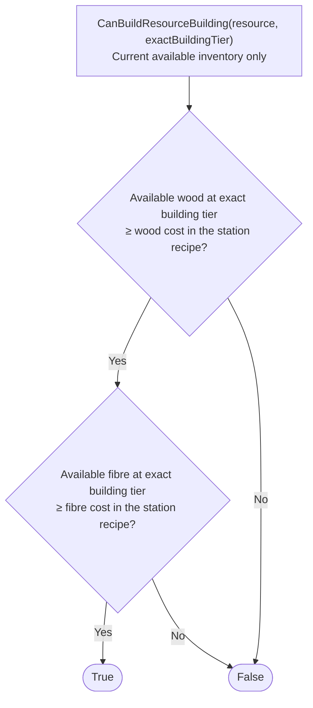

# CanBuildResourceBuilding

Status: typed condition draft, not integrated into the citizen controller.
Source of truth: [`can-build-resource-building.ts`](can-build-resource-building.ts). Mermaid is generated by [`../render.ts`](../render.ts).

## Responsibility

`CanBuildResourceBuilding(resource, exactBuildingTier)` returns whether **current available carried inventory** already covers the station's exact-tier wood and fibre recipe. It is side-effect-free and does nothing to obtain missing materials.

Resource selects the station: wood → lumbermill, fibre → spinning wheel, food → butchery. The caller supplies a valid resource and building tier. All three currently have the same costs, derived from `buildingRecipe` in [`src/world/config.ts`](../../../../src/world/config.ts):

- Wood: `6 * 2^(tier - 1)` units at the exact building tier.
- Fibre: `4 * 2^(tier - 1)` units at the exact building tier.
- Equality is sufficient. Missing item keys count as zero; higher/lower tiers cannot substitute.

Read `citizen.inventory`, which already excludes sell escrow and physically reserved work inputs. Do not add those quantities back, cancel their reservations/orders, count anticipated deliveries or consider gold. Caller-side allocation of these inputs remains the caller's responsibility; this intentionally narrow guard does not infer planning protections or other policy constraints.

**True means materials-ready, not that construction can start or a valid site exists.** Site selection, legal placement, movement, work availability and survival checks belong to the future placement action. Investment choice and arranging missing materials belong to its caller. No market flag is needed: market permissions/preferences do not affect this pure stock comparison.

## Generated diagram

## Verification boundary

Focused tests execute this declared graph with recipe costs and available-inventory facts, rather than supplying arbitrary decision booleans. They cover exact/excess stock, each shortage, absent/wrong-tier materials and unchanged state. Small real-engine setups confirm that sell escrow and work reservations are not available carried inventory; they do not implement the placement action or prove a complete construction plan.

See [the narrowed building discussion](../resource-building-brainstorm.md). Housing remains [a separate future proposal](../housing-and-rest-proposal.md).
