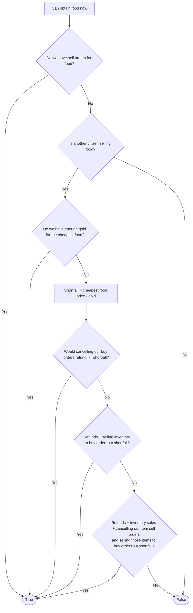

# CanObtainFoodNow

Condition only: returns `True` or `False` without issuing commands. A `True` result permits [ObtainFoodNow](obtain-food-now.md) on the same observation.

The diagram is generated from [`can-obtain-food-now.ts`](can-obtain-food-now.ts). Edit that typed draft for structural changes; the prose below records the feasibility contract.

Gold sufficiency refers to one unit of the cheapest available food. Funding checks are cumulative: remaining buy-order refunds, then inventory sales, then sales of recovered item sell escrow. Each gold check values available items against other citizens' buy orders at their bid prices and remaining quantities, counting each unit of demand once. Refunds use current remaining buy-order gold escrow. Recoverable items use current remaining sell escrow, not original listing quantities; these units cannot also count as inventory. Reserved work inputs are unavailable. Tools count too and can be sold directly from inventory. Building-sale proceeds and delayed deconstruction/salvage do not count.

The ordered checks accumulate possible funding sources; they do **not** prescribe which sources the action tree must use first. Citizen retention values, cancellation costs and gold utility guide action selection, not this boolean condition. There is no reasonable-price filter. Nothing is cancelled or sold during the check.

`True` describes the observed opportunity, not a promise that bids or food offers will still exist after subsequent commands. The caller checks request satisfaction before starting acquisition and evaluates this condition afresh before entry or resumption after an intermediate funding command. An initial `False` means do not start this route. If an active sequence loses its precondition, or the action is called despite unmet preconditions or cannot select an executable next command after a passed check, it fails loudly. Funding is intermediate progress; only actual food acquisition completes the action tree. Confirmed acquisition, automatic eating and order remainders belong to the surrounding execution context, not extra branches in the action tree.
