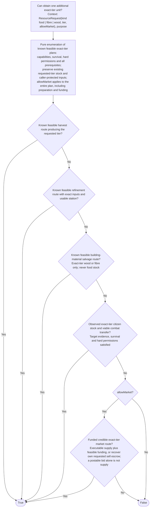

# CanObtainResource

Rough descriptive condition, paired with [`ObtainResource`](obtain-resource.md); **not implemented engine behavior**. The graph is generated from adjacent [`can-obtain-resource.ts`](can-obtain-resource.ts). See [resource acquisition design](../resource-acquisition-design.md) for shared cost and mechanic proposals.

## Request and result

API: `CanObtainResource(ResourceRequest { kind: 'food' | 'fibre' | 'wood', tier, allowMarket }, context)`. Purpose, current observation, capabilities and protected holdings are explicit context, not node state. There is no class framework or execution engine. The caller chooses the exact tier and loops for quantity. Each invocation concerns **one additional exact-tier unit**, not any substitutable tier or already-carried stock. Recovering the requested own sell escrow can add an available unit, but the same escrow cannot also count as carried stock.

The caller reconciles eligible, uniquely allocated delivery credit first, including externally delivered estate resources, then calls this condition before action entry and each unsatisfied resume at an idle command boundary, not every busy tick. Current feedback cannot yet supply all of this evidence; the [required delivery contract](../resource-acquisition-design.md#required-delivery-evidence-before-implementation) must be implemented first. A confirmed food delivery can satisfy acquisition even if automatically eaten; it does **not** satisfy a caller's ingredient-stock requirement. The recipe caller checks actual holdings separately. Track confirmed receipt rather than just inventory deltas.

## Feasibility, not preference

Enumeration is pure: inspect known facts without issuing commands, exploring or posting bids. A feasible plan includes the requested tier, reachable target, necessary tools, owned, alive, unlisted or feasibly preparable station, available exact recipe inputs, funding where needed, survival viability and hard travel/work/violence permissions. Tools do not wear or require servicing. A listed station is unusable until delisted, and market-off forbids that delisting. Known soft territory claims are not mechanical exclusions; existing permits/alliance access affect social risk, while a permit purchase is not currently command-expressible. Include the complete bounded dependency-ordered prerequisite plan; do not invent unknown resources or assume crafting/building is always necessary. Reserved inputs are unavailable. Existing available requested-tier stock is a protected baseline: candidate funding and material preparation cannot consume it to obtain a replacement. This restriction is inherited by every prerequisite, not traded off against preference scores. `allowMarket: false` excludes **all** market commands, including escrow recovery, bid cancellation, funding sales and prerequisite purchases, not just direct purchase.

The forward checks are existential: harvest, refinement, direct building-material salvage, evidenced viable combat transfer, then market-enabled acquisition. They are not a priority ranking. An expensive price, dislike of violence, preference for keeping property or a better alternative does not make a feasible route false. Survival and hard permissions do; desperation cannot override them. Action selection compares time, risk and preferences separately.

Harvest must credibly yield the exact tier; refinement must have a feasible input/station plan. Building salvage admits only evidenced exact-tier **wood/fibre materials**, never food stock. Combat requires observed evidence that the concrete target has transferable requested-tier stock, plus a viable encounter. Unknown inventory is not evidence. Public sell listings can evidence remaining exact-tier escrow stock. It is not carried inventory, but current death settlement releases escrow before transferring holdings to a living killer; stale evidence can change before arrival.

Market feasibility requires credible executable supply and a feasible funding combination, or actually recoverable requested own sell escrow. A funded, postable bid alone establishes demand, not supply. A hybrid is admissible only with `allowMarket: true`, funded bidding and a credible physical fallback already feasible here; bid-only feasibility admission remains an unresolved contract, not an implicit true branch. Unknown routes return false; exploration belongs to the caller.

## Proposed mechanics, not runtime claims

The current engine does not expose other citizens' carried inventories. Proposed **local visible carried inventories** would supply combat evidence; observation freshness/range and unique delivery attribution still need specification. Resolve repeated sightings by current visibility first, then latest observation date; do not add stock across historical sightings of one citizen. The redesign proposes removing ground loot entirely and redistributing natural-death estates—items, gold **and buildings**—among survivors with conservative rounded allocation. This is not current runtime behavior, guaranteed supply or a reason to predict a death. Only an actual delivered estate receipt can satisfy an active request. Combat transfer and direct salvage use the current mechanics described in the design document; any future death-policy changes need an explicit settlement contract. No ground-loot route exists in this draft.
