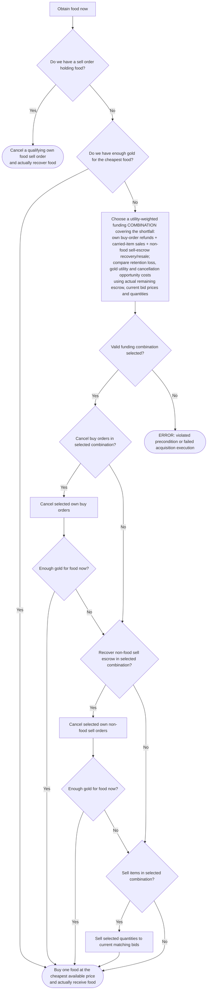

# ObtainFoodNow

Action-tree proposal, paired with [`CanObtainFoodNow`](can-obtain-food-now.md). Planning only; no controller or model calls are implemented by this document.

The diagram is generated from [`obtain-food-now.ts`](obtain-food-now.ts). Edit that typed draft for structural changes; the prose below records the execution contract and unresolved choices.

**Precondition:** the caller has checked [`CanObtainFoodNow`](can-obtain-food-now.md) on the current observation.

This tree represents **obtaining food**, not merely taking one step toward it. Its only successful terminals are actions that deliver food: buying food or cancelling an own food sell order to recover it. Raising money and recovering non-food items are intermediate actions, never successful terminals. The sole non-action terminal is an error.

Issue one command at a time while idle, not alongside physical work. After a confirmed intermediate action, continue the same acquisition sequence using updated observations and a fresh caller-side precondition check. Yielding for command feedback is not completing the tree. The current purchase terminal requests one food unit; larger purchase/reserve targets remain a caller-contract decision.

| Route | Forward execution | Successful terminal |
| --- | --- | --- |
| Direct buy | Enough gold → buy | `BuyFood` |
| Food escrow cancellation | Cancel own food listing → recover food | `CancelFood` |
| Refund-only funding | Cancel selected buy orders → buy | `BuyFood` |
| Inventory-sale-only funding | Sell selected carried quantities → buy | `BuyFood` |
| Recover/resell funding | Cancel selected non-food listings → sell recovered quantities → buy | `BuyFood` |
| Mixed funding | Execute selected refunds, recovery and sales → buy | `BuyFood` |
| Invalid precondition, selection or execution | Fail loudly with the violated assumption/feedback | `Error` (not success) |

The funding stages execute the **chosen combination**, not a priority between funding alternatives. The selector compares all sources together. Each rectangular funding action may issue multiple concrete cancellations or sales sequentially, one command at a time; it never signifies completion. Check affordability before each command within a stage and stop that stage as soon as food is affordable. The gold checks after refunds and escrow recovery then bypass all remaining funding and lead to `BuyFood`; after sales, proceed directly to `BuyFood`. Skip stages absent from the combination. Use confirmed results and current facts throughout, then actually buy food. There are no backwards arrows or ordinary success/wait leaves.

The existence of a funding route is established by the condition. The selector chooses among those routes; it does not repeat a separate feasibility tree. Reuse observed facts where useful. If no valid combination can be selected despite a passed condition, fail loudly, not with a silent fallback or another strategy. Any violated entry, resumption or execution assumption reaches the same `Error` outcome; these cross-cutting checks apply at every command boundary rather than adding repeated error arrows to the diagram.

## Caller and execution responsibilities

The caller determines whether the food request is already satisfied before starting the tree. It checks `CanObtainFoodNow` before entry and before every resume. After cancellation or sale, continue executing the selected combination using confirmed results, resulting holdings and the current market; do not resample the whole selection after each command. If changed facts invalidate the remaining combination's assumptions, surface an explicit execution error rather than silently selecting a different route. A false initial check means do not start this route. A failed check during an active sequence surfaces an explicit invalidated-precondition error and stops it; there is no ordinary unavailable terminal. Money raised or non-food items recovered do not satisfy the food request.

The execution layer owns confirmed results, request progress and any unfilled order remainder in explicit citizen-scoped context. Resolve that remainder before switching tasks; do not add cleanup/wait terminals to this tree. A food-producing terminal completes only on confirmed food delivery or recovery, including food automatically eaten before the next observation. Acceptance alone does not establish a fill. Command rejection or a change between checking and commitment must be surfaced as an explicit execution error with feedback, never disguised as success or a quiet no-op. Already committed effects are not undone, and no confirmed purchase is repeated.

## Funding selection and citizen item values

**Feasibility and preference are separate.** `CanObtainFoodNow` calculates whether food can be obtained; it does not judge reasonable prices or refuse a feasible route because the citizen prefers to retain an item. The action selector compares feasible funding combinations rather than enforcing the old fixed order of cancelling buy orders, selling inventory, then recovering sell escrow. A combination may contain several of these operations. Issue its commands sequentially as intermediate steps, then buy food; funding alone never completes this tree.

Use current bid prices and remaining quantities for sale proceeds, excluding the citizen's own bids and counting each unit of demand once. Buy-order cancellation refunds actual remaining gold escrow, not the order's original value. Sell-order cancellation recovers actual remaining item escrow; those same units cannot also count as carried inventory. Reserved work inputs are unavailable. Tools are ordinary saleable inventory items. If several food listings can be cancelled, select one sufficient for this request rather than cancelling all of them.

The proposed value mechanism combines cheap heuristics with occasional LLM-preprocessed citizen preferences:

- **Retention value:** importance of keeping an item to this citizen's goals and current situation. Distinguish the best matching tool from a spare, goal inputs from surplus, and intended goal ingredients from unrelated stock. Evaluate the actual quantity lost and what remains afterward, not one fixed rank per item kind. Intended ingredients are a preference; already reserved inputs are unavailable.
- **Gold utility:** benefit of the actual proceeds in the current situation, especially closing an urgent food shortfall. Extra gold may also have value, but its marginal benefit need not remain constant once the immediate need is covered.
- **Order-cancellation cost:** opportunity cost of withdrawing an existing buy or sell commitment. Recovering one's own escrow is not new income and should not be scored as free profit; compare the resulting liquidity and lost opportunity.

For a sale, a starting heuristic is `utility of gold received - retention utility lost`. Compare complete funding combinations, including cancellation costs, on a consistent utility scale. An item with retention worth **1.0** that sells for **20 gold** may be preferable to one worth **0.9** that sells for **2 gold**; raw rank alone does not capture the money gap. These illustrative retention values are not gold prices or a settled scoring calibration. A proceeds-to-retention ratio may help rank candidates, but is not sufficient to choose quantities or a complete combination.

Choose a combination that funds the request, accounting for indivisible units and any useful excess proceeds. Execute its components sequentially in the graph's forward order, validating remaining assumptions against confirmed results and current facts before each command. Stop raising funds once the purchase is affordable; skip any remaining unnecessary funding components and proceed to `BuyFood`, rather than liquidating every item with a positive sale score. Do not resample the entire combination after each command; invalidated assumptions produce the explicit error outcome.

An occasional LLM review could produce compact retention weights, priorities or conditional tables from the citizen's goals and observed situation. Store them explicitly per citizen with their observation date and goal revision. Refresh periodically or after meaningful goal/situation changes, not after every trade. The local selector still calculates current quantities and executable prices; model estimates must not substitute for market facts. Missing or stale preferences use default heuristics, and urgent food acquisition must not wait for a new model call. Refresh cadence, representation and utility calibration remain proposals to verify, not an implemented contract.

## Scope and remaining choices

Buildings are not liquidation candidates in this immediate food-funding tree: do not count building-sale proceeds or attempt to recover buildings as item sell escrow. The desired direction is deconstruction/salvage rather than building sales; that takes physical work and belongs to a delayed route, not `ObtainFoodNow`. The current engine still supports building trading; changing that mechanic is separate work, not part of this documentation update.

Before implementation, settle purchase quantities, the request's exact satisfaction contract, funding search bounds, utility calibration, preference refresh triggers and tie-breaking. Ground verification in coherent engine-generated sequences covering multi-source funding, continuation from funding through actual food delivery, fresh condition checks after market changes, loud errors for invalid entry/resumption or missing actions, execution-layer handling of partial fills/remainders and automatic eating, and best-tool versus spare-tool choices.
