# ObtainResource

Rough action sketch paired with [`CanObtainResource`](can-obtain-resource.md), **not an executable controller**. Its generated graph comes from adjacent [`obtain-resource.ts`](obtain-resource.ts); shared heuristics and mechanic proposals belong in [resource acquisition design](../resource-acquisition-design.md).

API: `ObtainResource(ResourceRequest { kind: 'food' | 'fibre' | 'wood', tier, allowMarket }, context)`. The caller chooses tier and loops for quantity; this tree obtains **one additional exact-tier unit**. Existing carried stock is not new acquisition. Snapshot existing available requested-tier stock as a protected baseline; neither funding nor any prerequisite may sell or consume it to buy/produce its replacement. This prevents repeated one-unit requests from undoing previous accumulation. Confirmed delivery can satisfy this acquisition request even when food is automatically eaten. A recipe caller must separately check actual available ingredient stock; an eaten unit cannot satisfy that holding requirement.

```mermaid
flowchart TD
    Start["Obtain one additional exact-tier unit<br/>Context: ResourceRequest(kind food | fibre | wood, tier, allowMarket), purpose"]
    ExternalReceipt{"Confirmed new target unit from an incidental transfer?"}
    ReceiveTransfer(["Receive the requested exact-tier unit from a confirmed external transfer;<br/>settle owned work/orders before handoff; never predict a natural death"])
    Enumerate["Admit only fully-budgeted complete known plans and their prerequisites:<br/>harvest, refine, material salvage, evidenced combat, purchase, own sell escrow;<br/>protect the baseline and inherit survival, hard permissions and allowMarket<br/>for the whole candidate including its preparation and funding;<br/>never spend existing requested-tier stock or caller-protected inputs"]
    Select["Select and retain concrete target, path, bounded preparation sequence, inputs,<br/>tool/station and funding choices; compare travel + work + wait ETA,<br/>gold/material costs, residual recovery burden and risk,<br/>desperation, violence preference and ownership;<br/>hybrid needs funded bid + credible fully-budgeted physical fallback"]
    Valid{"Complete route respects permissions and protected stock?"}
    Hybrid{"Selected market-enabled hybrid?"}
    MarketHybrid{"Selected hybrid still MarketAllowed<br/>under the frozen request permissions?"}
    PostBuy["Fund and post selected one-unit exact-tier bid;<br/>retain owned order handle, no delivery on acceptance"]
    Filled{"Confirmed requested receipt already delivered?"}
    NeedsPreparation{"Any selected-route prerequisite still unmet<br/>(station, tool, exact inputs, prerequisite travel/funding)?"}
    PreparePrerequisites["Execute the ONE selected bounded preparation sequence, dependency-ordered:<br/>follow actual input/tool/station dependencies, including needed travel/funding,<br/>under inherited permissions<br/>and protected stock; fixed plan from selection, no unbounded recursion,<br/>no mandatory tool/station build"]
    Purchase{"Chosen route is purchase?"}
    MarketPurchase{"Selected purchase still MarketAllowed<br/>under the frozen request permissions?"}
    FundPurchase["Execute selected funding only if needed; stop once affordable;<br/>gold or recovered non-target items alone do not complete the request"]
    PurchaseResource(["Buy the selected exact-tier resource and actually receive a filled unit;<br/>an accepted unfilled order is still in progress, not success"])
    ReceiveBuy(["Receive the requested additional exact-tier unit from an actual buy fill;<br/>resolve owned work/order before handoff"])
    RequestedEscrow{"Chosen route recovers requested own sell escrow?"}
    MarketEscrow{"Selected escrow recovery still MarketAllowed<br/>under the frozen request permissions?"}
    RecoverEscrow(["Cancel selected requested listing and actually recover<br/>one additional exact-tier unit into available holdings"])
    Harvest{"Chosen route is harvest?"}
    MoveToHarvest["Travel selected known admissible path to harvest target<br/>(skip if already at the target)"]
    HarvestResource(["Harvest until confirmed delivery of the requested exact-tier unit;<br/>other-tier output or movement is not success"])
    Refine{"Chosen route is refinement?"}
    MoveToStation["Travel selected admissible path to usable refinement station<br/>(skip if already at the target)"]
    RefineResource(["Refine selected inputs and confirm additional requested exact-tier output"])
    Salvage{"Chosen route is building-material salvage?"}
    MoveToBuilding["Travel selected admissible path to evidenced material-yield building<br/>(skip if already at the target)"]
    SalvageResource(["Destroy the selected building and receive exact-tier wood or fibre salvage;<br/>damage/destruction without target delivery is not success; no food stock"])
    Combat{"Chosen route is evidenced viable combat transfer?"}
    MoveToCitizen["Travel selected admissible path to exact-tier evidenced citizen target<br/>(skip if already at the target)"]
    CombatTransfer(["Defeat the selected citizen and receive the requested exact-tier item;<br/>attack or kill without requested delivery is not success"])
    Error(["ERROR: retained-context invalidated precondition, route, execution or timeout;<br/>settle ALL request-owned orders incl funding sells and stop owned work before handoff;<br/>keep ownership, frozen market permission and pending terminal state in cleanup Context;<br/>report feedback"])
    Start --> ExternalReceipt
    ExternalReceipt -->|Yes| ReceiveTransfer
    ExternalReceipt -->|No| Enumerate
    Enumerate --> Select
    Select --> Valid
    Valid -->|Yes| Hybrid
    Valid -->|No| Error
    Hybrid -->|Yes| MarketHybrid
    Hybrid -->|No| NeedsPreparation
    MarketHybrid -->|Yes| PostBuy
    MarketHybrid -->|No| Error
    PostBuy --> Filled
    Filled -->|Yes| ReceiveBuy
    Filled -->|No| NeedsPreparation
    NeedsPreparation -->|Yes| PreparePrerequisites
    NeedsPreparation -->|No| Purchase
    PreparePrerequisites --> Purchase
    Purchase -->|Yes| MarketPurchase
    Purchase -->|No| RequestedEscrow
    MarketPurchase -->|Yes| FundPurchase
    MarketPurchase -->|No| Error
    FundPurchase --> PurchaseResource
    RequestedEscrow -->|Yes| MarketEscrow
    RequestedEscrow -->|No| Harvest
    MarketEscrow -->|Yes| RecoverEscrow
    MarketEscrow -->|No| Error
    Harvest -->|Yes| MoveToHarvest
    Harvest -->|No| Refine
    MoveToHarvest --> HarvestResource
    Refine -->|Yes| MoveToStation
    Refine -->|No| Salvage
    MoveToStation --> RefineResource
    Salvage -->|Yes| MoveToBuilding
    Salvage -->|No| Combat
    MoveToBuilding --> SalvageResource
    Combat -->|Yes| MoveToCitizen
    Combat -->|No| Error
    MoveToCitizen --> CombatTransfer
```

## Selection, bounded preparation and forward execution

Pure enumeration produces known admissible complete candidates and admits **only fully-budgeted known plans**: the plan's budget must cover preparation, funding and all market commands it will issue, alongside the protected baseline and the market permission inherited unchanged from the frozen request. Selection retains concrete target/path, the bounded preparation sequence, exact inputs, funding choices and estimates in explicit execution context. Compare travel, work and fill-wait ETA with gold/material opportunity cost, residual food/recovery burden, contested-area risk, desperation, violence propensity and ownership. Recovery can overlap work; do not blindly append the full healing duration to ETA. Low health constrains encounter survival; destroying one's own useful building has a different loss from another's. Preferences rank feasible routes, never relax hard permissions or manufacture supply. No known candidate means loud `Error`, not silent exploration.

The separate tool/station/input phases are replaced by **one unified bounded preparation phase**: `NeedsPreparation → PreparePrerequisites` executes the single selected, dependency-ordered preparation sequence before route dispatch — the actual input/tool/station dependencies plus necessary travel and funding. A station can precede a tool when its ingredients need refinement; a tool can precede a station when its materials need harvesting. There is no universal ordering of these categories. The sequence is fixed at selection, performs no unbounded recursion and demands no mandatory tool build or station build; prerequisites already satisfied dispatch immediately. A price change alone does not re-open admission while the selected physical fallback remains valid and fully budgeted — `Can` stays true and re-ranking belongs to the caller's selection context, not an automatic route switch.

`allowMarket: false` forbids every market command throughout the candidate, including prerequisite purchases, funding sales/cancellations and requested sell-escrow recovery. The condition tree's shared candidate-feasibility guard applies to the whole candidate, but it is **not the sole protection**: each market-route branch re-checks its explicit execution gate — `MarketHybrid` before `PostBuy`, `MarketPurchase` before `FundPurchase`/`PurchaseResource`, and `MarketEscrow` before `RecoverEscrow` — against the permission frozen at selection. A route erroneously selected despite a frozen market-off request terminates in the loud `Error` with cleanup; it never silently switches to a physical route. A hybrid requires market permission, funded bidding and a credible known physical fallback. Posting its one-unit bid is preparation, not delivery; an immediate confirmed fill finishes through `ReceiveBuy`; otherwise the unfilled hybrid continues into bounded physical-fallback preparation and dispatch.

Binary dispatch then follows the selected route: market-gated purchase funding and actual fill; market-gated requested own sell-escrow recovery; travel (skipped when already at the target) and harvest; travel to the station and refinement; travel and direct material salvage; or travel and evidenced combat transfer. Funding runs only if needed and stops once affordable; submission/acceptance is not delivery. Preparation stages execute the retained bounded plan, not unbounded recursive tree calls. No preparation, movement, bid acceptance, damage or kill is a successful terminal. Harvesting the wrong tier also does not complete the request. Losing both known routes of a hybrid (fill gone and fallback invalidated) remains a loud `Error` with cleanup — it is never relaxed into forecast-only waiting.

## Cross-cutting receipt and interruption contract

All graph nodes are stateless descriptions. Citizen-scoped context holds request/purpose, acquisition baseline, route assumptions, confirmed receipts, progress, deadlines and owned order/work handles. Check **confirmed receipt first** on entry and every command boundary, including resumes; external estate delivery may satisfy the request without another purchase. Committed receipts are captured **before** re-checking `CanObtainResource` at idle boundaries; the cheap busy-tick check does not call `Can` on every busy tick, and nothing overrides an already-committed receipt. If unsatisfied, the caller rechecks `CanObtainResource` before entry/resume and validates the retained route, rather than silently selecting a replacement. A false initial condition means do not enter; invalidation during execution, rejection, missing requested output or timeout surfaces the single loud `Error` with feedback. Committed effects are not undone or repeated.

Every handoff — success, deliberate abort, a resumed request whose `Can` turned false, and timeout or engine rejection — runs the same ownership cleanup before control returns: settle **all request-owned orders** including any funding sells, and stop owned queued work beforehand. Cleanup is issued under the **original frozen market-permission context** of the request and continues until it is confirmed that no owned escrow or order remains abandoned, even when the next requested task forbids market actions. Request arguments do not change in place. There is no unconditional cancelling of an unrelated mixed queue: the current cancel clears the entire queue, so during this request its active and queued physical work is assumed request-owned. A cleanup that itself fails retains the pending terminal and ownership context and starts no new task; there is no early drop. Actual delivery arriving during error cleanup is classified authoritatively **receipt-first**: a target delivery committed before closure may establish acquisition success exactly once while the execution error remains diagnostic; a racing second delivery is surplus to reconcile — never a reason to reopen or duplicate the request.

During **any preparation, travel or attack command boundary**, a hybrid's actual fill can finish via the explicit `ReceiveBuy` terminal. An actual incidental allocation or transfer can instead finish via `ReceiveTransfer`; it is not a predicted route. Stop unnecessary further effects and cancel/resolve request-owned remaining orders and work before handing control back. Do not cancel unrelated work or orders. A receipt is not permission to ignore cleanup, repeat a purchase or complete an already unnecessary attack. The same receipt-first rule handles externally confirmed estate fills. This is cross-cutting execution context, not a hidden graph node or backwards-arrow loop. Exact busy-action interruption, cancellation races and in-flight effects remain a **draft settlement contract**, not implemented mechanics. Issue commands sequentially, await authoritative feedback and never report success until actual requested receipt is established. Recipe callers still check ingredient holdings rather than treating every receipt as retained stock.

### Required structured receipt evidence (future engine contract)

The current engine's receipt data is **insufficient** to satisfy this contract. Before the action's auto-food boundary fires, a future actor-visible **structured commit** must record the delivery: delivery IDs, source handles (order, station, building, citizen) and the exact quantity and kind/tier of each delivered item. Per request, the context must additionally keep an **eligibility cursor** for that request, the **credited quantity** so far, and **acknowledgment retention across reload**. Fills and deliveries are never inferred from a deleted order row, raw inventory deltas or event text, and bounded execution logs are not a durable acknowledgment of committed delivery. The parent main document ([resource acquisition design](../resource-acquisition-design.md), [plan](../plan.md)) specifies these delivery-record details; this draft links to it and adds no new ledger class or framework here.

## Proposed settlement boundaries

Direct building salvage yields evidenced exact-tier **wood/fibre materials only**, not food stock. Combat needs concrete exact-tier target-stock evidence and confirmed transfer; killing without receiving the requested item fails. **Public sell-stock evidence alone supports combat viability even before proposed visible carried inventories exist**, provided the seller's location is independently known and reachable — a live listing evidences transferable stock, not global omniscience; revalidate listing quantity and location at approach. Proposed local visible carried inventories are **not current observation behavior**. Current death settlement releases escrow before transfer to a living killer, so listed-stock and carried-stock evidence are distinct sources. Revalidate stale evidence and do not count the same units twice. The redesign removes ground loot and redistributes natural-death items, gold and buildings among survivors with conservative rounded allocation; the proposed inventory/death changes are **not implemented** and do not guarantee this caller a unit. Combat, salvage, redistribution rounding and escrow-transfer details require authoritative contracts. Bid-only admission, heuristic calibration, deadlines and busy interruption remain rough choices to settle before implementation.